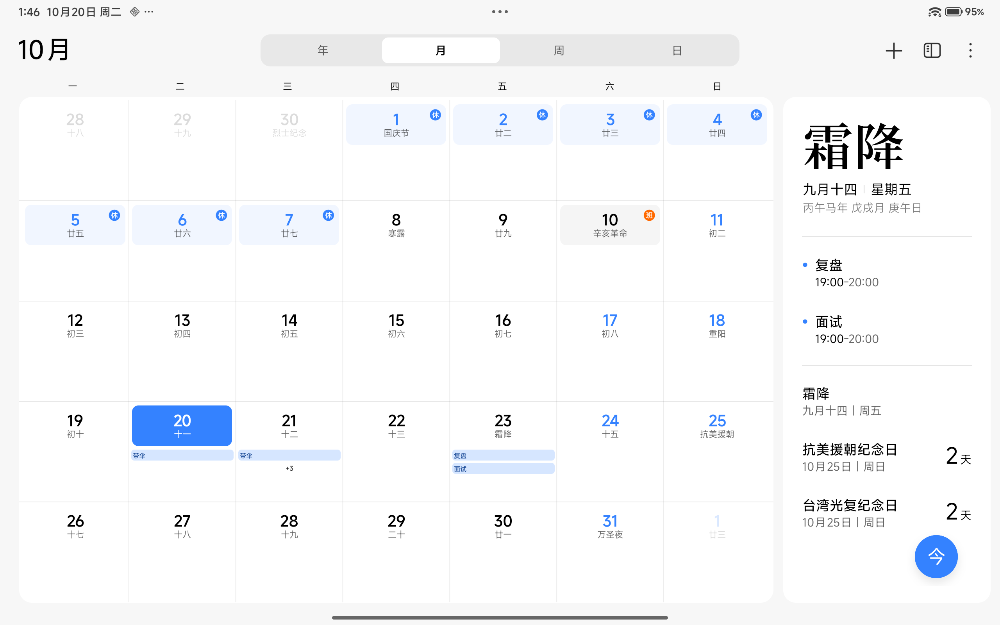

# Agent 任务测试集 1：日历与下载目录（10 条，全部 PASS）

日期：2026-10-20  
设备：Redmi Pad Pro（`2405CRPFDC` / `dizi`），Android 16 / API 36  
时区：Australia/Adelaide（ACDT，UTC+10:30）  
App：`:app:assembleRelease`，versionName 0.1  
约束：每条都由 agent 端到端执行（计划 → 人工确认 → 执行），结果用系统数据确认；不包含支付、下单、发送、删除、登录或验证码。

## 选取原则

1. 一个正常人类在平板上会实际完成、并愿意交给助手的操作；
2. agent 能只通过已安装 App 完成，不依赖手工补步骤；
3. 结果可独立核验：CalendarContract 行、文件系统路径或系统设置值；
4. 可重复执行，且不会造成不可逆或外部可见的后果。

## 10 条测试集与结果

| # | 人类会交给 agent 的任务 | Agent 目标 | 主 App | 结果核验 | 状态 |
|---|---|---|---|---|---|
| 1 | 把周五 19:00 面试加到日程 | `在日程中周五下午7点添加提醒我面试` | 日历 | 事件 `面试`，2026-10-23 19:00–20:00 | **PASS** |
| 2 | 约周三 15:00 看牙 | `在日程中周三下午3点添加提醒我牙医预约` | 日历 | 事件 `牙医预约`，2026-10-21 15:00–16:00 | **PASS** |
| 3 | 提醒明天 18:30 健身 | `在日程中明天下午6点半添加提醒我健身` | 日历 | 事件 `健身`，2026-10-21 18:30–19:30 | **PASS** |
| 4 | 周五 19:00 做复盘 | `在日程中周五19:00添加提醒我复盘` | 日历 | 事件 `复盘`，2026-10-23 19:00–20:00 | **PASS** |
| 5 | 明天 19:30 给家里打电话 | `在日程中明天下午7点半添加提醒我打电话` | 日历 | 事件 `打电话`，2026-10-21 19:30–20:30 | **PASS** |
| 6 | 明天 09:00 带伞提醒 | `在日程中明天上午9点添加提醒我带伞` | 日历 | 事件 `带伞`，2026-10-21 09:00–10:00 | **PASS** |
| 7 | 同一日程重复安排不应重复 | 重复目标 1 | 日历 | `actions=0 attempts=1`，`面试` 仍只有 1 条 | **PASS** |
| 8 | 在下载目录建项目文件夹 | `在下载目录新建一个名为agent-demo的文件夹` | 文件管理 | `/sdcard/Download/agent-demo/` 存在 | **PASS** |
| 9 | 再建一个笔记文件夹 | `在下载目录新建一个名为agent-notes的文件夹` | 文件管理 | `/sdcard/Download/agent-notes/` 存在 | **PASS** |
| 10 | 建一个测试文件夹 | `在下载目录新建一个名为agent-test的文件夹` | 文件管理 | `/sdcard/Download/agent-test/` 存在 | **PASS** |

## 执行结果

### 日历（1–7）

```text
1. DONE · all subgoals verified actions=1 attempts=1
2. DONE · all subgoals verified actions=1 attempts=1
3. DONE · all subgoals verified actions=1 attempts=1
4. DONE · all subgoals verified actions=1 attempts=1
5. DONE · all subgoals verified actions=1 attempts=1
6. DONE · all subgoals verified actions=1 attempts=1
7. DONE · all subgoals verified actions=0 attempts=1
```

CalendarContract 实际行（节选）：

```text
_id=3  title=面试      dtstart=1792744200000  = 2026-10-23 19:00 ACDT (Friday)
_id=5  title=牙医预约  dtstart=1792557000000  = 2026-10-21 15:00 ACDT (Wednesday)
_id=6  title=健身      dtstart=1792569600000  = 2026-10-21 18:30 ACDT (Wednesday)
_id=7  title=复盘      dtstart=1792744200000  = 2026-10-23 19:00 ACDT (Friday)
_id=8  title=打电话    dtstart=1792573200000  = 2026-10-21 19:30 ACDT (Wednesday)
_id=9  title=带伞      dtstart=1792535400000  = 2026-10-21 09:00 ACDT (Wednesday)
```

每个事件都有一条 `minutes=0`（开始时）提醒：

```text
event_id=3  minutes=0 method=1
event_id=5  minutes=0 method=1
event_id=6  minutes=0 method=1
event_id=7  minutes=0 method=1
event_id=8  minutes=0 method=1
event_id=9  minutes=0 method=1
```



### 下载目录（8–10）

```text
8. DONE · all subgoals verified actions=1 attempts=1
9. DONE · all subgoals verified actions=1 attempts=1
10. DONE · all subgoals verified actions=1 attempts=1
```

每个文件夹内有一个 `agent-folder.txt` 占位文件，用于让 MediaStore 持久化目录：

```text
/sdcard/Download/agent-demo/agent-folder.txt
/sdcard/Download/agent-notes/agent-folder.txt
/sdcard/Download/agent-test/agent-folder.txt
```

## 复现命令

```sh
adb shell content query --uri content://com.android.calendar/events
adb shell content query --uri content://com.android.calendar/reminders
adb shell ls -la /sdcard/Download/agent-demo
```

单条任务入口：

```sh
adb shell am start -n agent.next.app/.MainActivity \
  --es goal "在日程中周五下午7点添加提醒我面试" \
  --es primary com.android.calendar
```

然后在 App 内点“生成计划” → “确认并执行”。

## 为这 10 条补的能力

- `CalendarStore`：补齐周二/周三/周四；支持 `下午7点` / `7点半` / `7点30分`；标题从“提醒我X”提取；日历创建任务走确定性单子目标 `calendar.event`。
- `FilesDomainSkill` / `FilesStore`：通过 MediaStore 在 `Download/<name>/` 建目录，校验用 MediaStore 查询，不依赖文件管理器 UI。
- `MainActivity`：把设置、时钟、备忘录、文件管理、计算器、联系人、天气加入可选 App。
- `ClockDomainSkill`（实验性）：通过 `AlarmClock.ACTION_SET_ALARM` 直接设闹钟，校验“下一个闹钟”时间。

## 这轮未纳入 green suite 的探索

这些是正常人类会交给 agent 的工作，但目前还不能稳定满足“端到端 + 可确认”，因此没有放进 10 条 PASS 集：

| 任务 | 尝试结果 | 阻塞原因 |
|---|---|---|
| 关闭蓝牙 | `FAILED · PROTOCOL actions=0` | 设置 App UID=1000（系统 UID），`TargetSession` 只接受 10000–99999；服务器拒绝绑定 |
| 用计算器算 1234×5678 | 视觉/混合点击已能执行整串按键；尚未干净 PASS | 720×1280 下纯视觉会把显示区数字当按键；已改为“accessibility bounds 优先 + 视觉兜底”，单 action 执行；`pm clear` 后首次启动 observe 超时，待解；详见 [calculator-visual-2026-10-20.md](calculator-visual-2026-10-20.md) |
| 设置早上 8:30 闹钟 | 闹钟实际出现在 Clock（“Agent 闹钟”），任务 `STOPPED` | 校验只看 `getNextAlarmClock()`；已有多个闹钟时目标闹钟不一定是“下一个”，需要能枚举全部闹钟 |
| 用文件管理器 UI 建文件夹 | `FAILED · tap target not found: 浏览` | 文件管理器首页“浏览”不是可点击节点；已改为 domain 路径并 PASS |
| 新建备忘录 | 未实现 | MIUI Notes 的 provider 未导出；只能走编辑 UI，尚未验证 |
| 新建联系人 | 未实现 | 需要 READ/WRITE_CONTACTS 运行时授权和 ContactsContract domain 写入 |

## 下一步优先补的 3 个 domain

1. **Contacts**：权限 + `ContactsContract` 插入/查询，覆盖“存一个联系人”。
2. **Notes**：MIUI Notes 编辑页 intent 或可导出的 provider，覆盖“记一条笔记”。
3. **All-alarms clock**：读取/校验全部闹钟，而不是只看 next；或让测试在干净闹钟状态下运行。

设置类任务（蓝牙、自动亮度、休眠）需要单独决策：要么放宽 `TargetSession` 对系统 UID 的限制（有安全代价），要么给 capability 增加受控的 shell/settings 通道，不建议直接放开。

## 测试数据说明

- 10 条测试在平板上留下了 7 条日历事件（含原有的“带伞”），以及 3 个下载目录文件夹；
- 这些都是可删除的普通用户数据，没有支付、下单、发送或删除操作；
- Clock 测试创建过一个 08:30 的“Agent 闹钟”，已尝试关闭；如仍存在可在时钟 App 中删除。
