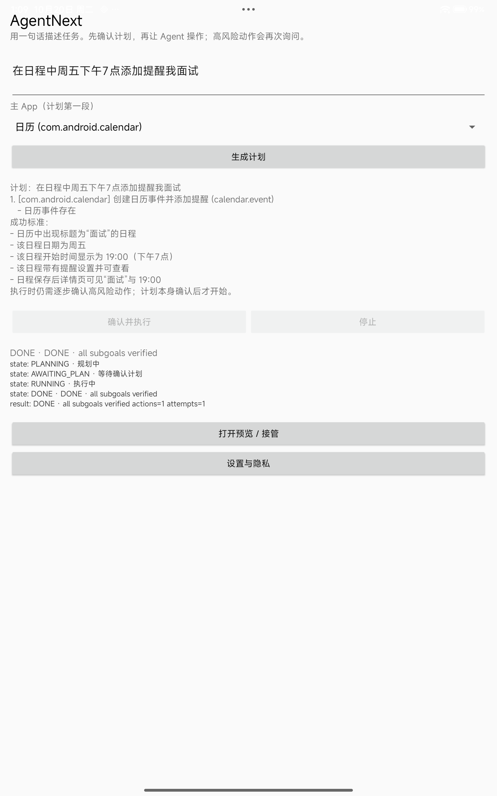
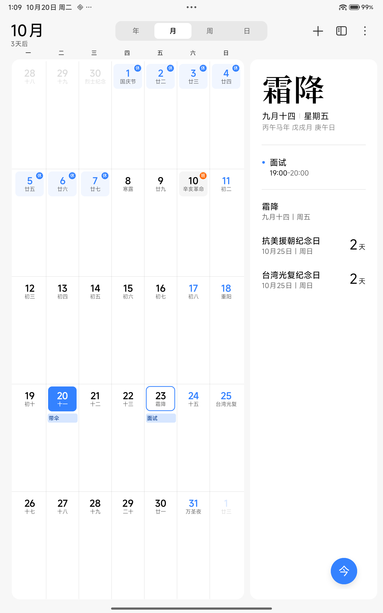

# Calendar E2E：周五 19:00 面试提醒（Redmi Pad Pro）

日期：2026-10-20  
设备：Redmi Pad Pro（`2405CRPFDC` / `dizi`），Android 16 / API 36  
宿主/设备时区：Australia/Adelaide（ACDT，UTC+10:30）  
App：`:app:assembleRelease`（versionName 0.1），adb 覆盖安装，保留加密 model config  
Shizuku：13.6，`shizuku_server` 以 shell UID 运行

## 目标

```text
在日程中周五下午7点添加提醒我面试
```

主 App：`com.android.calendar`。

## 结果

```text
计划：1. [com.android.calendar] 创建日历事件并添加提醒 (calendar.event)
state: RUNNING · 执行中
state: DONE · DONE · all subgoals verified
result: DONE · all subgoals verified actions=1 attempts=1
```

CalendarContract 中的实际事件：

```text
_id=3
title=面试
dtstart=1792744200000  -> 2026-10-23 19:00:00 ACDT (Friday)
dtend=1792747800000    -> 2026-10-23 20:00:00 ACDT
eventTimezone=Australia/Adelaide
hasAlarm=1
reminder: event_id=3, minutes=0, method=1 (ALERT)
```

复跑同一目标：`DONE actions=0 attempts=1`，`title=面试` 的事件仍只有 1 条，幂等生效。

日历月视图在 10 月 23 日显示「面试 19:00–20:00」；事件带一条“开始时”提醒。





## 本次修改

1. `CalendarStore.parseTime` 支持口语时间：
   - `周五下午7点` → 19:00；
   - `7点半` / `7点30分`；
   - 原有 `19:00` / `下午7.30` 保持。
2. 标题解析：
   - 从目标中的「提醒我X」或「标题为X」提取；
   - 目标与 subgoal intent 分开解析，避免把「创建日历事件并添加提醒」拼进标题；
   - 「面试」不再使用旧的固定标题「准备 Agent 开发面试」。
3. `CalendarDomainSkill.fixedPlan`：
   - 对「创建/添加/设置 + 日历/日程/提醒」的日历任务，固定为单个 `calendar.event` 子目标；
   - 避免 planner 生成 visual 子目标、而 domain 又用 CalendarContract 直接写入导致的 verifier 不一致；
   - 写入仍是 `CalendarInsertAction`，经 RiskGate，未新增权限。

## 边界

- 这是 domain action（CalendarContract），不是通过日历 UI 点击；日历 UI 只用于人工查看结果。
- 幂等键是 `title + dtstart`；同一时间已有同名事件时不会重复写入。
- 标题提取仍是轻量规则，不含完整自然语言时间/标题解析；「今天」「下周五」等相对日期尚未区分。
- 本次未删除已有「带伞」事件，也未改系统日历账户；测试事件保留在设备本地日历。

## 证据

- 计划/完成截图：`docs/assets/calendar-e2e-done.png`
- 日历月视图：`docs/assets/calendar-e2e-day-view.png`
- 原始截图、logcat：`work/calendar-e2e-2026-10-20/`（gitignored）
