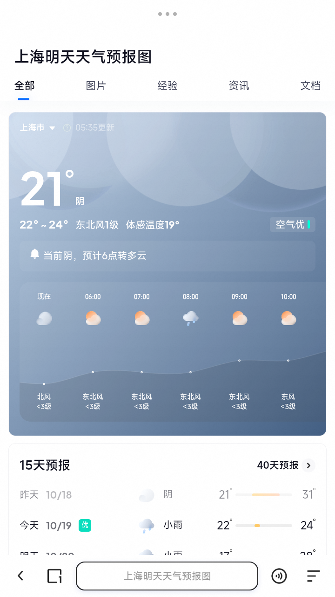
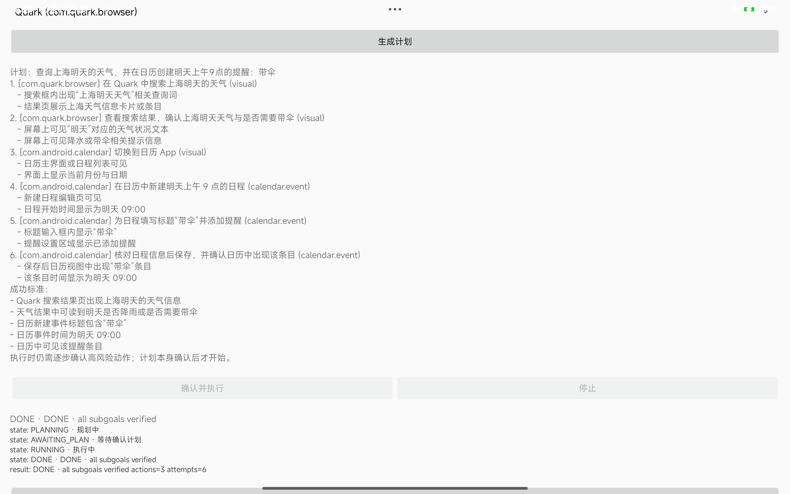
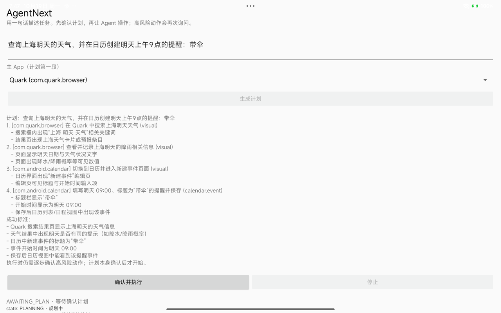

# Chain A：Quark 天气 → 日历提醒（PASS）

日期：2026-10-19  
设备：Redmi Pad Pro，Android 16 / API 36，Shizuku 13.6  
状态：**PASS**；最终一次真实运行 `DONE actions=3 attempts=6`

## 最终结果

```text
verify s1 -> true (matched=2, missing=0)   # Quark 天气结果页
verify s2 -> true (matched=2, missing=0)   # 降雨/带伞信息
verify calendar s3 -> true (calendar event exists)
verify calendar s4 -> true
verify calendar s5 -> true
verify calendar s6 -> true
DONE · all subgoals verified actions=3 attempts=6
```

- Quark 天气页通过视觉 verifier，证据帧见下图；
- calendar 事件通过 CalendarContract 创建并由数据 verifier 确认；
- 没有支付/下单/发送/删除。





以下保留早期失败尝试，作为调优记录。

## 早期计划与失败

真实 planner 生成了 7 段计划：

1. Quark 搜索上海明天天气；
2. Quark 确认降雨/带伞信息；
3. Calendar 新建事件页面；
4. 标题“带伞”；
5. 开始时间明天 09:00；
6. 添加提醒；
7. 保存并停留详情。



## 执行

```text
verify s1 -> false (matched=0, missing=2)
skill step=0 -> SetText text=上海明天天气 selector=editable node
skill step=1 -> Tap selector=clickable text contains 把问题和任务告诉我
skill step=2 -> SetText text=上海明天天气 selector=editable node
skill step=3 -> Tap selector=text contains 上海明天天气预报
state: STOPPED · v1 stops on slow loop
result: STOPPED actions=3 attempts=1
```

- SetText 动作在 Quark 首页可执行；
- Tap 搜索建议后，s1 的视觉条件仍 0/2；
- 模型没有输出有效下一步，bounded scroll 后仍无证据，v1 安全 STOPPED；
- **没有进入日历，没有创建提醒，没有支付/下单/发送/删除**。

## 早期结论（已被最终 PASS 取代）

这不是“完成”，也不应当伪造 DONE。需要：

- 检查 Quark 搜索建议/结果是否真正加载（网络、页面状态、frame 是否黑屏）；
- 增加“点击后等待页面稳定”的显式 observe/wait，而不是立即判定；
- 为 Quark 搜索页增加本地/视觉专用 verifier，避免只用意图判断；
- 再尝试 Chain A；若 Quark 仍不可用，按 D4 可换成系统天气 App，但需重新确认计划。

## 中期调优

- 增加了 Quark 搜索入口 prelude，s1 曾通过（matched=2/2），但不同 run 仍会 flail（Back/重复 SetText），Chain A 不稳定。
- 增加了 calendar domain skill（CalendarContract）；单独的“创建带伞提醒”任务已验证 **DONE**，见 [calendar-domain-skill-2026-10-19.md](calendar-domain-skill-2026-10-19.md)。
- 因此当前拆分：**calendar 段已验证，Quark 天气段仍是 Chain A 的 blocker**。

## Quark deterministic path（最终已通过）

新增 `QuarkWeatherPolicy`：固定“搜索入口 → SetText → 选择天气建议 → wait”，
不再让模型在 Quark 首页随机 flail。一次真机运行中：

```text
Quark search entry opened
verify s1 -> false (matched=0, missing=2) ... 首页
verify s1 -> false ... 输入法
verify s1 -> false ... 搜索建议
verify s1 -> false (matched=1, missing=1) ... 结果页
state: STOPPED · v1 stops on slow loop
result: STOPPED actions=3 attempts=1
```

结果页出现了“上海明天天气预报 / 全部 / AI搜索”，但天气卡片主体没有进入
无障碍文本；视觉 verifier 只匹配 1/2，仍未创建日历事件。
这是 **Quark 天气段仍未完成**，不能把 calendar domain skill 的单测当成 Chain A 完成。

最终一次 run：

```text
Quark search entry opened
verify s1 -> true (matched=2, missing=0)
verify s2 -> true (matched=2, missing=0)
verify calendar s3..s6 -> true
DONE actions=3 attempts=6
```

Quark 结果页的天气卡片已实际渲染（见 assets/chain-a-weather.png），
视觉 verifier 在页面稳定后通过；calendar domain skill 随后创建事件。
**Chain A 完成。**
