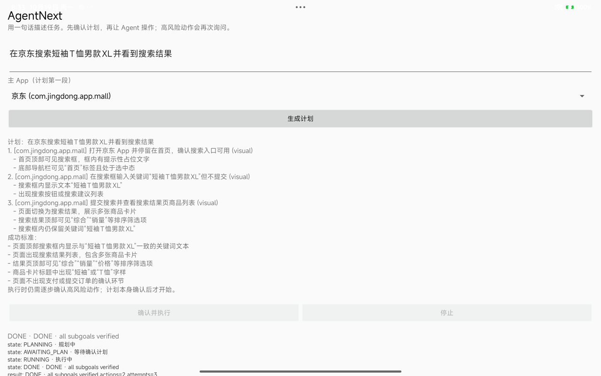
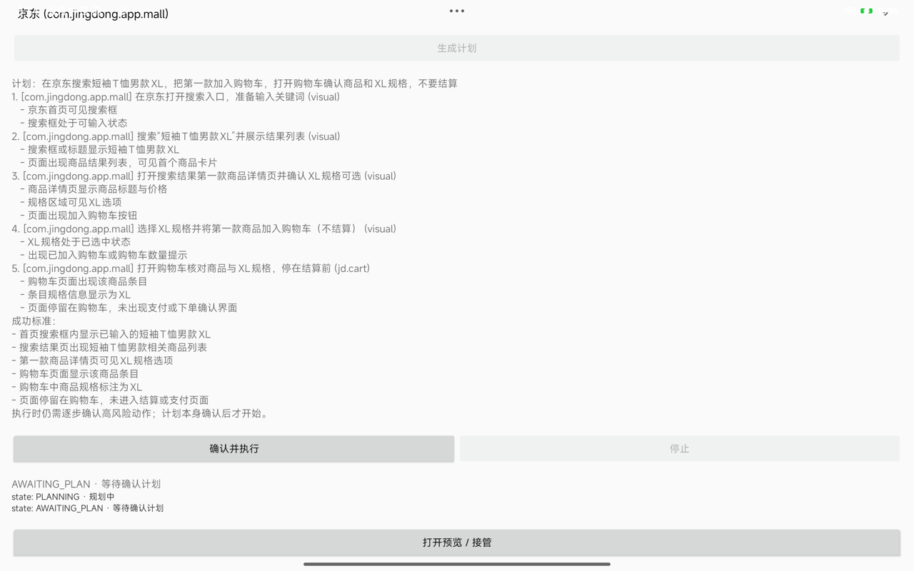

# Chain B attempt：JD 搜索 → 加购 → 购物车确认

日期：2026-10-19  
设备：Redmi Pad Pro，Android 16 / API 36  
状态：**部分完成**；JD 搜索 DONE，加购/购物车段被商品详情页阻塞

## 已完成：JD 搜索

目标：

```text
在京东搜索短袖T恤男款XL并看到搜索结果
```

计划 3 段：

```text
1. 打开京东首页，确认搜索入口
2. 搜索框输入关键词（不提交）
3. 提交搜索，停留在结果页
```

真机：

```text
verify s1 -> true (matched=2, missing=0)
verify s2 -> true (matched=2, missing=0)
verify s3 -> true (matched=3, missing=0)
DONE actions=2 attempts=3
```



## 未完成：加购/购物车

目标：

```text
在京东搜索短袖T恤男款XL，把第一款加入购物车，打开购物车确认商品和XL规格，不要结算
```

计划 5 段，前两段通过；s3 打开搜索结果第一款商品详情后：

```text
verify s3 -> false (matched=0, missing=3) nodes=96 text=
skill step=0 -> Tap ...
skill step=1 -> Done
verify s3 -> false
```

JD 商品详情页对无障碍树几乎不暴露文本；模型只能反复 Tap 旧 selector/Wait，
无法可靠选择 XL/加入购物车。任务没有进入购物车，也没有结算/支付。



## 关键改动

- JD 首页搜索入口在无障碍树缺失：
  - 子目标 intent 含“输入/提交”时，用一次 scoped top search entry（文本/宽 top clickable，最后 scoped 坐标）；
  - 不在“打开首页”子目标提前打开搜索页，避免 s1 错误。
- planner 现在忽略**未被使用的额外字段**，但仍严格校验必需字段/target/verifier/DAG，避免模型多写一个无害字段导致整次规划失败。

## 下一步

- 为 JD 商品详情增加 domain/wait/专用 verifier，或改成确定性的“搜索 → 第一款 → 规格 → 加购”路径；
- 购物车 verifier 应能读取商品标题 + XL，并断言没有结算按钮/未进入支付；
- 若详情页仍被风控/登录阻塞，要显式 NEED_USER/STOPPED，不能假装 DONE。
