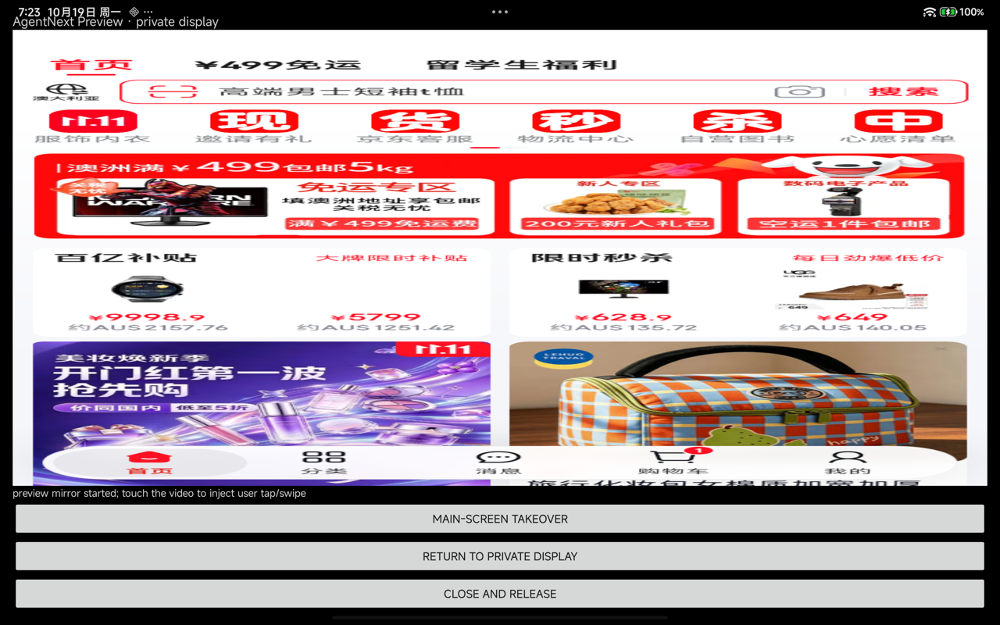
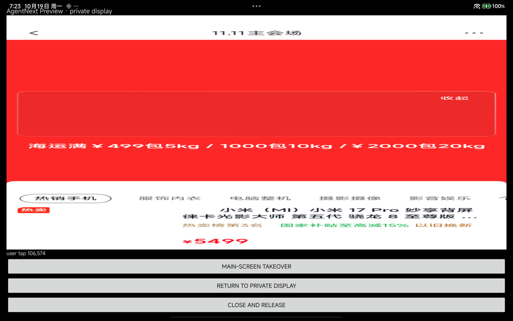
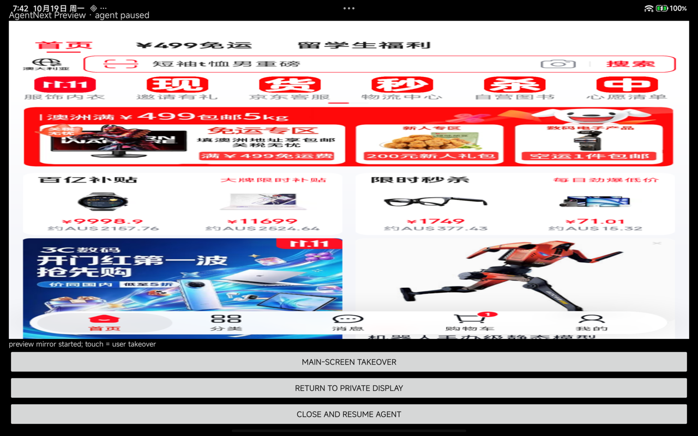

# Preview mirror / touch takeover smoke（Android 16 平板）

日期：2026-10-19  
设备：Redmi Pad Pro `2405CRPFDC`，Android 16 / API 36，Shizuku 13.6  
版本：`d67a0ed` + `PreviewActivity` 工作区改动  
性质：standalone 真机 smoke，还不是产品 runtime/UI

## 入口

debug 构建提供直接入口（release 仍为 `exported=false`）：

```sh
adb -s 9ec7fe43 install -r app/build/outputs/apk/debug/app-debug.apk
adb -s 9ec7fe43 shell am start -n agent.next.app/.PreviewActivity
```

`PreviewActivity` 自己连接 Shizuku、创建 private display、打开京东、在 TextureView
上启动 mirror；触摸事件归一化到 720×1280 后调用 capability-only
`AndroidPreviewController.userTap/userSwipe`。

## 结果

```text
AgentNextPreview: connect
AgentNextPreview: connected: display=d2f86329-... target=ed596f92-...
AgentNextPreview: preview mirror started; touch the video to inject user tap/swipe
AgentNextPreview: user tap 106,574
AgentNextPreview: target moved to main screen; use system UI, then return
AgentNextPreview: target returned to private display
AgentNextPreview: preview mirror started; touch the video to inject user tap/swipe
```

- **mirror 启动 PASS**：TextureView 显示京东私有 display 画面。
- **用户触摸 PASS**：屏幕点击经 PreviewActivity 映射为私有 display 的 `userTap`；
  京东从首页进入 11.11 会场，截图见下图。
- **主屏接管 PASS**：目标移到主屏后，京东 Activity 位于前台；返回私有 display
  后 mirror 重新启动成功。
- **返回后画面**：京东处于风控/活动页，截图接近黑屏；这是目标 App 当前页面和
  风控状态，不是 mirror 启动失败。未继续绕过风控。





## 限制

- 本 smoke 由 `PreviewActivity` 自己持有 `BlockingDeviceApi`，尚未接入产品
  `AgentRuntime`；与 agent loop 并存、暂停/恢复和前台服务是 Phase 3。
- debug manifest 才允许 adb 直接 start；release `PreviewActivity` 不导出。
- 尚未在 Android 13 手机上重复；手机 gate 仍未完成。
- 未验证双指缩放、长按、输入法、拖动等复杂手势；当前只有 tap/swipe。
- 未验证返回后 mirror 画面持续刷新；本次返回页恰为风控页，未做进一步判断。

## 共享 AgentRuntime 版（2026-10-19 追加）

`PreviewActivity` 已改为绑定 `AgentRuntime`，不再自己连接 Shizuku：

- runtime 先 `pauseForUser()`；`RuntimeControl.checkpoint` 在下一步前阻塞；
- PreviewActivity 使用 runtime 的 display/target 启动 mirror；
- 触摸通过 runtime 的 `previewTap/previewSwipe` 注入；
- 关闭预览调用 `resumeAfterUser()`，agent 从新的 observe 继续；
- preview 操作使用独立 `previewWorker`，不会被正在跑模型/循环的 session worker 阻塞。

真机日志：

```text
AgentNextPreview: preview mirror started; touch = user takeover
AgentNextPreview: user tap 106,574
AgentNextRuntime: verify s1 -> true (matched=2, missing=0)
AgentNextRuntime: verify s2 -> true (matched=2, missing=0)
AgentNextRuntime: verify s3 -> true (matched=2, missing=0)
AgentNextRuntime: verify s4 -> true (matched=2, missing=0)
state: DONE · all subgoals verified
```

该 run 中预览打开期间 agent 暂停，用户触摸后关闭预览，agent 恢复并完成 4 段 plan，**DONE**。



限制：

- 预览打开期间不会自动 resume；必须关闭预览；
- preview 与 agent 的并发仍共用同一 `BlockingDeviceApi`，目前靠 pause + 独立 worker 避免重叠；
- 尚未实现前台服务/通知；Activity 被系统回收时 runtime 也会丢失。
