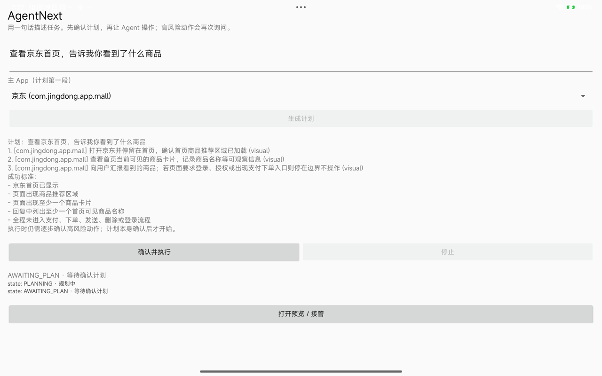
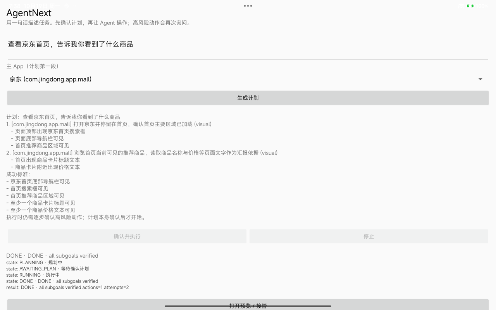

# Product UI / plan review smoke（Android 16 平板）

日期：2026-10-19  
设备：Redmi Pad Pro，Android 16 / API 36，Shizuku 13.6  
性质：Phase 3 第一版产品壳 + runtime 接线，不是完整 Beta

## 已完成入口

`MainActivity` 现在是 launcher：

- 自然语言目标输入；
- 主 App 选择（默认京东；实际安装才显示）；
- “生成计划”；
- 计划审阅：subgoal 的 target/intent/verifier/postconditions、task success criteria；
- “确认并执行”/“停止”；
- 高风险动作弹窗确认（`UiHumanGateway`）；
- 运行状态和 SessionResult 日志；
- PreviewActivity 入口。

`AgentRuntime` 负责：

```text
connect Shizuku -> private display
  -> DeepSeekTaskPlanner
  -> AWAITING_PLAN
  -> user confirms
  -> SessionRunner
       -> TargetBinder per subgoal
       -> PromptSessionPolicyFactory
       -> VisualSubgoalVerifier
       -> StageExtractor
  -> DONE / NEED_USER / STOPPED / FAILED
```

## 实测（第二版：scroll fallback + 移除 Back 能力）

第一版曾出现 s2 模型返回 `Done`、verifier 只有 1/2 条件满足，v1 安全 STOPPED。
第二轮做了两个约束：

- `PromptSessionPolicyFactory` 不再授予 `BACK` capability，避免模型在“浏览首页”阶段误退；
- 新增 `ScrollAction` + `ScrollFallbackPolicy`：模型没有下一步且 verifier 未通过时，最多执行
  2 次**基于当前窗口 bounds** 的只读滚动，再重新 observe/verify；不使用模型给出的坐标。

最新一次真实运行：

```text
AgentNextRuntime: verify s1 -> true (matched=3, missing=0)
AgentNextRuntime: verify s2 -> false (matched=1, missing=1)
AgentNextRuntime: skill step=0 -> Done
AgentNextRuntime: verify s2 -> true (matched=2, missing=0)
state: DONE · DONE · all subgoals verified
result: DONE · all subgoals verified actions=1 attempts=2
```

结论：

- 真实模型生成 2 段计划；计划审阅和人工确认边界工作；
- SessionRunner 正确绑定京东 target；
- s1 视觉 verifier 通过；
- s2 模型返回 Done 但 verifier 未满足，`ScrollFallbackPolicy` 执行 1 次滚动；
- 重新 observe 后 s2 的 2/2 postconditions 满足，最终 **DONE actions=1 attempts=2**；
- 没有执行下单/支付/发送/删除，没有错误提交。





## 已知缺口

- 计划质量仍取决于模型：subgoal 数量/措辞会变化；当前是“查看首页”安全任务。
- `PreviewActivity` 目前仍自己持有 API，尚未共享 `AgentRuntime` 的 display/target，也尚未在触摸时暂停 loop。
- 没有前台服务/常驻通知；Activity 关闭会中止 runtime 生命周期。
- 没有计划编辑/澄清回填；澄清只展示问题。
- 未做加密 memory/settings/隐私页。
- Android 13 手机未连接。
- `PreviewActivity` 目前仍自己持有 API，尚未共享 `AgentRuntime` 的 display/target，也尚未在触摸时暂停 loop。
- 没有前台服务/常驻通知；Activity 关闭会中止 runtime 生命周期。
- 没有计划编辑/澄清回填；澄清只展示问题。
- 未做加密 memory/settings/隐私页。
- Android 13 手机未连接。
